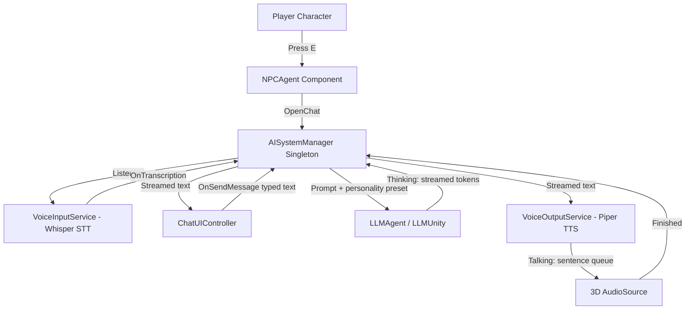

# 🤖 Local AI Driven NPCs System

[](https://unity.com/)
[](LICENSE)
[](https://unity.com/)
[](https://github.com/oguzhan00yildiz/Unity-Local-AI-Driven-NPCs)
[](AIPackageInstaller/package.json)

A free, **100% on-device AI NPC system** for Unity. NPCs listen to the player, think and answer with a voice. Speech-to-Text (Whisper), a Large Language Model (LLMUnity) and Text-to-Speech (Piper) run as one chain on the player's computer.

> 🔒 **100% Local & Private**: No cloud APIs and no API fees. The package collects no data. It only connects to Hugging Face to download the models during setup.

---

## 🌟 Key Features

- 💬 **Local LLMs on CPU/GPU**: [LLMUnity](https://github.com/undreamai/LLMUnity) (llama.cpp) runs any GGUF model (**Qwen 3.5**, **Llama 3**, **Mistral**, **Phi-3**, etc.). GPU mode uses CUDA or Vulkan and falls back to the CPU.
- 🎙️ **Local Speech Recognition (STT)**: [Whisper Unity](https://github.com/Macoron/whisper.unity) with voice activity detection. Recording stops after 1 second of silence.
- 🗣️ **Neural Text-to-Speech (TTS)**: [Piper TTS](https://github.com/lookbe/piper-no-espeak-unity) speaks the answer sentence by sentence while the LLM is still writing. Each NPC can have its own voice.
- 🎭 **ScriptableObject Personality Presets**: Set the NPC name, system prompt and voice in the Inspector. Two presets come ready: **Grumpy Guard** and **Helpful Guide**.
- ⚡ **One-Click Setup Window**: Downloads all models, installs what is needed and sets the default model on the LLM prefab.
- 🎯 **Modular Architecture**: Separate services (`AISystemManager`, `VoiceInputService`, `VoiceOutputService`, `ChatUIController`, `NPCAgent`) bind at runtime. Use only the parts you need, for example the chat panel without the microphone.
- ⌨️ **Text Chat**: Players can also type to the NPC in the chat panel.

---

## ⚡ Quick Setup

### Option A: Unity Asset Store (recommended)

The Asset Store version bundles LLMUnity, Whisper, Piper and ONNX Runtime in `ThirdParty/`. No Git or npm setup is needed.

1. Get the package from the [Unity Asset Store](https://assetstore.unity.com/packages/slug/405036) and import it. Confirm the required Unity packages when Unity asks.
2. Click **Import** in the import window.
3. Click **Download** when the **AI System Setup** window asks to download the models. You can cancel the download.
4. Open `Assets/AI Driven NPCs System/Scenes/AIOScene.unity`.
5. Press **Play**, walk to an NPC and press **E**.

> ⚠️ **Conflict:** Remove any separate copies of LLM for Unity, Piper, Whisper or ONNX Runtime (`com.github.asus4.onnxruntime`) first. Two copies cause duplicate assembly errors.

### Option B: Git URL (Unity Package Manager)

1. In Unity, open **Window → Package Manager**.
2. Click **+** → **Add package from git URL…** and paste:
   ```text
   https://github.com/oguzhan00yildiz/Unity-Local-AI-Driven-NPCs.git?path=AIPackageInstaller
   ```
3. The installer adds the npm registry for ONNX Runtime and installs LLMUnity, Piper and Whisper from Git.
4. In **Package Manager**, select **AI Driven NPCs System** → **Samples** → **Import**.
5. Open `Assets/Samples/AI Driven NPCs System/2.4.2/Scenes/AIOScene.unity` and press **Play**.

> ⚠️ **Important:** Keep the Unity Editor open and focused during setup. Unity can pause background downloads when it loses focus.

### Downloaded Models

The setup window downloads 9 files to `Assets/StreamingAssets/` and assigns them to the prefabs:

| Component | Model / Asset | Size | Purpose |
| :--- | :--- | :--- | :--- |
| **STT** | `Whisper/ggml-tiny.bin` | 74 MB | Speech-to-text |
| **TTS Core** | `PiperTTS/model.onnx` + `phoneme_dict.json` + `tokenizer.json` | ~70 MB | Phonemizer and tokenizer |
| **Voices** | `en_US-bryce-medium` (male) and `en_US-ljspeech-medium` (female) | 61 MB each | Voices of the two demo NPCs |
| **LLM** | `Qwen3.5-0.8B-Q4_K_M.gguf` | 508 MB | Default language model |

The default LLM is small and fast. It works on the CPU alone. For a real game, use a bigger model and a stronger system prompt. Small models drop out of their role more often.

#### 🔄 Use a Different LLM
1. In the scene, expand the `AISystem` prefab and select the **`LLM`** GameObject.
2. On the **`LLM`** component, open the **Model** dropdown:
   - **Download Presets:** Download popular models in Unity (Llama 3, Mistral, Gemma, Phi-3, etc.).
   - **Custom Model:** Select or drag any `.gguf` file.
3. Press **Play**.

---

## 🏗️ Architecture Overview

`AISystemManager` sits in the middle and passes data between the services. Whisper returns an event, LLMUnity streams tokens and Piper plays a queue of sentences.



The chat panel shows the NPC state: **Listening**, **Thinking** or **Talking**. The microphone is off while the NPC thinks and talks, so the NPC does not hear its own voice. Whisper and the LLM warm up when the scene loads, so the first answer has no extra delay. The player can end a conversation by walking away.

### Core Scripts

| Component | Role | Description |
| :--- | :--- | :--- |
| [`AISystemManager.cs`](Assets/AI%20Driven%20NPCs%20System/Scripts/AISystem/Core/AISystemManager.cs) | **Coordinator** | Central singleton. Manages the chat lifecycle, cursor lock, player movement and events. |
| [`ModelBootstrapper.cs`](Assets/AI%20Driven%20NPCs%20System/Scripts/AISystem/Core/ModelBootstrapper.cs) | **Warmup** | Warms up the LLM and Whisper models in the background when the scene loads. |
| [`NPCAgent.cs`](Assets/AI%20Driven%20NPCs%20System/Scripts/AISystem/NPC/NPCAgent.cs) | **NPC** | On the NPC GameObject. Handles the interaction area, the prompt cue and the personality preset. |
| [`NPCPersonalityPreset.cs`](Assets/AI%20Driven%20NPCs%20System/Scripts/AISystem/NPC/NPCPersonalityPreset.cs) | **Preset** | ScriptableObject with the NPC name, system prompt and voice. |
| [`VoiceInputService.cs`](Assets/AI%20Driven%20NPCs%20System/Scripts/AISystem/Services/VoiceInputService.cs) | **Speech-to-Text** | Microphone capture, silence detection and Whisper transcription. |
| [`VoiceOutputService.cs`](Assets/AI%20Driven%20NPCs%20System/Scripts/AISystem/Services/VoiceOutputService.cs) | **Text-to-Speech** | Cleans the text, splits it at `.` `!` `?` and plays the sentences through Piper. |
| [`ChatUIController.cs`](Assets/AI%20Driven%20NPCs%20System/Scripts/AISystem/UI/ChatUIController.cs) | **UI** | Chat history, streamed text, input field, microphone selection and mute button. |

---

## 🎭 Creating Custom NPC Personalities

1. Right-click in the Project view: **Create → AI System → Personality Preset**.
2. Set the fields:
   - **NPC Name**: e.g., `Captain Valerie`
   - **System Prompt**:
     ```text
     You are Captain Valerie, a battle-hardened sky pirate.
     Speak with confidence and a pirate flair. Keep your answers under 2 sentences. Do not use emojis.
     ```
   - **Voice**: e.g., `en_US-bryce-medium` or `en_US-ljspeech-medium`.
3. Drag the preset into the **Personality Preset** field of the NPC's `NPCAgent`. The preset sets both the system prompt and the voice.

Give the NPC a name in the prompt. Without a name, small models answer with their own model name.

---

## 💻 C# API Reference

### 1. Start a Conversation From Code
```csharp
using AISystem;
using UnityEngine;

public class QuestDialogueTrigger : MonoBehaviour
{
    [SerializeField] private NPCAgent targetNPC;

    public void OnQuestTargetReached()
    {
        // Opens the chat panel, locks player controls and starts listening
        AISystemManager.Instance.OpenChat(targetNPC);
    }
}
```

### 2. Direct LLM Query (Streaming)
```csharp
using LLMUnity;
using UnityEngine;

public class CustomAIQuery : MonoBehaviour
{
    [SerializeField] private LLMAgent llmAgent;

    public async void AskQuestion(string prompt)
    {
        string reply = await llmAgent.Chat(
            prompt,
            callback: partial => Debug.Log($"Streamed: {partial}"),
            completionCallback: () => Debug.Log("Response completed!")
        );
    }
}
```

### 3. Speak Custom Text
```csharp
using AISystem;
using UnityEngine;

public class AnnouncerSystem : MonoBehaviour
{
    [SerializeField] private VoiceOutputService voiceOutput;

    public void Announce(string message)
    {
        // Splits the text into sentences and plays them through Piper
        voiceOutput.Speak(message, "en_US-bryce-medium");
    }
}
```

---

## 🛠️ Editor Tools

All tools are under **Tools → AI Packages**:

- **AI System Setup**: Opens on its own after import. Shows the setup status and downloads the models.
- **Download Model Files**: Downloads the missing model files.
- **Voice Browser**: Downloads or deletes Piper voices with one click. All 9 listed voices are public domain or CC0, so they can ship in commercial games: LJSpeech, LJSpeech High, Kristin, Kathleen, Bryce, John, Norman, Joe and Ibrahim.
- **System Health & GPU**: Shows the GPU, VRAM, CPU and RAM. One switch moves all LLM layers to the GPU.
- **Force Install Dependencies** (Git URL version only): Runs the package installer again.

---

## 🔧 System Requirements & Scope

- **Unity**: Unity 6 (6000.0) or newer. Most work was done on 6000.3.
- **Render Pipeline**: The demo scene and prefabs use URP. The scripts also work in Built-in and HDRP with your own scene.
- **Unity packages**: Input System, uGUI, URP, Newtonsoft Json and Collections. Unity installs them as dependencies.
- **Operating System**: Windows 10/11 64-bit. Other platforms are not supported.
- **Language**: Whisper and Piper are set up for English. The LLM can answer in other languages, but the full chain was tested in English only.
- **RAM**: 8 GB minimum (16 GB recommended).
- **GPU (optional)**: NVIDIA (CUDA) or AMD (Vulkan) with 4 GB+ VRAM for faster answers.

---

## ⚖️ Responsible Use

The package does not filter model answers. The developer is responsible for what the NPC says. Write your rules into the preset's system prompt or add your own filter. Tell players that NPC answers are generated at runtime by an LLM.

---

## 🗺️ Roadmap

- **NPC actions**: The LLM turns the player's words into game commands, for example "give drink".

---

## 📄 License & Attributions

This project uses the **MIT License**. The bundled tools keep their own licences. See [ThirdPartyNotices.md](Assets/AI%20Driven%20NPCs%20System/ThirdPartyNotices.md).

- [LLMUnity](https://github.com/undreamai/LLMUnity) by undreamai (Apache 2.0).
- [whisper.unity](https://github.com/Macoron/whisper.unity) by Macoron (MIT).
- [piper-no-espeak-unity](https://github.com/lookbe/piper-no-espeak-unity) by lookbe (MIT). [Piper](https://github.com/rhasspy/piper) voices by Rhasspy.
- [ONNX Runtime Unity](https://github.com/asus4/onnxruntime-unity) by asus4 (MIT).
- [Qwen3.5-0.8B GGUF](https://huggingface.co/unsloth/Qwen3.5-0.8B-GGUF) by Qwen Team and Unsloth (Apache 2.0).

---

## 💬 Support & Contact

- **Issues & Bug Reports:** [GitHub Issues](https://github.com/oguzhan00yildiz/Unity-Local-AI-Driven-NPCs/issues)
- **Email Support:** [oguzhan00yildiz@gmail.com](mailto:oguzhan00yildiz@gmail.com)
- **Author:** Oguzhan Yildiz
