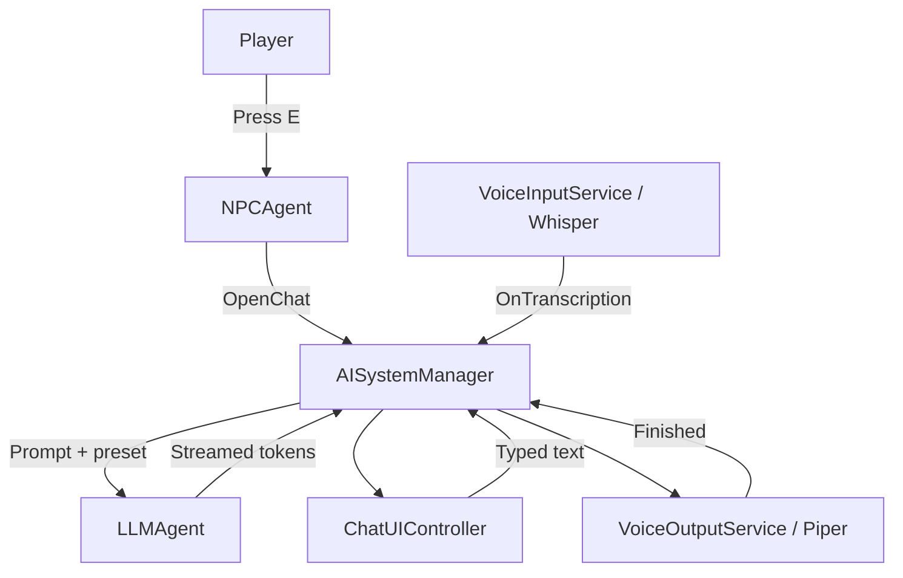

# Local AI Driven NPCs System

[](https://unity.com/)
[](LICENSE)
[](https://unity.com/)
[](AIPackageInstaller/package.json)

A free Unity package for NPCs that listen, think and talk. Three models run on the player's computer:

- **Whisper** turns the player's speech into text ([whisper.unity](https://github.com/Macoron/whisper.unity)).
- **An LLM** writes the answer ([LLMUnity](https://github.com/undreamai/LLMUnity), any GGUF model).
- **Piper** speaks the answer ([piper-no-espeak-unity](https://github.com/lookbe/piper-no-espeak-unity)).

No cloud API and no API fees. The package collects no data. It only connects to Hugging Face to download the models.

## Install

### Asset Store (recommended)

LLMUnity, Whisper, Piper and ONNX Runtime come bundled in `ThirdParty/`.

1. Import the package from the [Unity Asset Store](https://assetstore.unity.com/packages/slug/405036). Confirm the Unity packages when asked.
2. Click **Import**.
3. Click **Download** in the **AI System Setup** window. A dialog asks whether to include the DemoQuest models. You can cancel the download.
4. When the downloads finish, click **Open DemoQuest**.
5. Press **Play**, walk to an NPC and press **E**.

Remove other copies of LLMUnity, Piper, Whisper or ONNX Runtime first. Two copies cause duplicate assembly errors.

### Git URL

1. In **Window → Package Manager**, click **+** → **Add package from git URL…** and paste:
   ```text
   https://github.com/oguzhan00yildiz/Unity-Local-AI-Driven-NPCs.git?path=AIPackageInstaller
   ```
2. The installer adds the npm registry for ONNX Runtime and installs LLMUnity, Piper and Whisper from Git.
3. Import the **AI Driven NPCs System** sample, then open `Assets/Samples/AI Driven NPCs System/2.6.2/Scenes/DemoQuest.unity`.

Keep Unity focused during setup. Unity can pause downloads in the background.

### Downloaded models

The setup downloads 9 files to `Assets/StreamingAssets/`:

| Stage | Files | Size |
| :--- | :--- | :--- |
| STT | `Whisper/ggml-tiny.bin` | 74 MB |
| TTS core | `PiperTTS/model.onnx`, `phoneme_dict.json`, `tokenizer.json` | ~70 MB |
| Voices | `en_US-bryce-medium`, `en_US-ljspeech-medium` (+ `.json`) | 61 MB each |
| LLM | `Qwen3.5-0.8B-Q4_K_M.gguf` | 508 MB |

The default LLM is small and runs on the CPU. Small models drop out of their role more often. For a real game, use a bigger model: select the `LLM` object in the `AISystem` prefab and pick a model in the **Model** dropdown.

DemoQuest uses bigger models. The setup asks before it downloads them:

| Files | Size |
| :--- | :--- |
| `Qwen3.5-4B-Q4_K_M.gguf` | 2.7 GB |
| `Whisper/ggml-small.en.bin` | 490 MB |
| 6 voices: john, kristin, norman, joe, cori, alba | 380 MB |

If you skip them, add them later with **Tools → AI Packages → Download DemoQuest Models**.

## DemoQuest

`Scenes/DemoQuest.unity` is a short quest in the village of Elmford. Skeletons stole the Blue Stone. Talk to Elder Emil, find out where the stone went, convince the gate guard Ville, fight the skeletons at the ruins with your companion Aada, and bring the stone back. The LLM writes every NPC line live.

- Hold **E** near an NPC and speak. Look at the NPC you want to talk to.
- Ask Aada to follow, stay, fight or go somewhere.
- 15 characters, 9 voices, music and sound effects.
- A GPU with 6 GB of VRAM is recommended.

Scripts used: `StoryLore`, `QuestManager`, `NPCKnowledge`, `WorldState`, `NPCActions` and the combat scripts.

`Scenes/BasicExample.unity` has one NPC with the minimal setup.

## How it works



- The chat panel shows the NPC state: **Listening**, **Thinking** or **Talking**.
- Recording stops after 1 second of silence. The microphone is off while the NPC thinks and talks.
- Piper speaks each sentence while the LLM still writes the next one.
- Whisper and the LLM load when the scene starts, so the first answer has no extra delay.
- The player can type in the chat panel. The chat panel works without the microphone.
- Walking away ends the conversation.

| Script | Job |
| :--- | :--- |
| [`AISystemManager`](Assets/AI%20Driven%20NPCs%20System/Scripts/AISystem/Core/AISystemManager.cs) | Passes data between the services. Handles the chat, cursor and player movement. |
| [`ModelBootstrapper`](Assets/AI%20Driven%20NPCs%20System/Scripts/AISystem/Core/ModelBootstrapper.cs) | Loads Whisper and the LLM when the scene starts. |
| [`NPCAgent`](Assets/AI%20Driven%20NPCs%20System/Scripts/AISystem/NPC/NPCAgent.cs) | Interaction area, prompt cue and personality preset of one NPC. |
| [`VoiceInputService`](Assets/AI%20Driven%20NPCs%20System/Scripts/AISystem/Services/VoiceInputService.cs) | Microphone, silence detection and Whisper. |
| [`VoiceOutputService`](Assets/AI%20Driven%20NPCs%20System/Scripts/AISystem/Services/VoiceOutputService.cs) | Splits text at `.` `!` `?` and plays it through Piper. |
| [`NPCActions`](Assets/AI%20Driven%20NPCs%20System/Scripts/AISystem/NPC/NPCActions.cs) | Runs UnityEvents when the LLM writes a tag such as `[FOLLOW]`, or when the player's words match a keyword. |
| [`TalkAnimator`](Assets/AI%20Driven%20NPCs%20System/Scripts/AISystem/NPC/TalkAnimator.cs) | Plays a talking gesture layer and nods the head while the NPC's voice plays. |
| [`ChatUIController`](Assets/AI%20Driven%20NPCs%20System/Scripts/AISystem/UI/ChatUIController.cs) | Chat history, text input, microphone choice and mute. |

## NPC personalities

1. **Create → AI System → Personality Preset**.
2. Set **NPC Name**, **System Prompt** and **Voice**:
   ```text
   You are Captain Valerie, a sky pirate. Speak with confidence.
   Keep your answers under 2 sentences. Do not use emojis.
   ```
3. Drag the preset into the **Personality Preset** field of `NPCAgent`. It sets the prompt and the voice.

The package ships 12 presets for common roles, such as Grumpy Guard (voice bryce) and Helpful Guide (voice ljspeech). Give each NPC a name in the prompt. Without one, small models answer with their own model name.

## Voices and pronunciation

- If a voice says a name wrong, add a line to `Prefabs/PronunciationLexicon.txt`, for example `aada: ah duh`.
- `PiperTTS` settings: **Noise Scale** and **Noise W** (lower is clearer), **Target Loudness** (same volume for all voices).

Asset Store version only. The Git URL version uses Piper from Git without these settings.

## Talking animation

Add `TalkAnimator` to an NPC with a Humanoid Animator. The head nods while the NPC speaks. For gestures, add an Animator layer named **Talk** with `UpperBodyMask` and a talking clip, as in the DemoQuest animators.

## C# API

```csharp
// Open a conversation with an NPC
AISystemManager.Instance.OpenChat(targetNPC);

// Ask the LLM directly, with streaming
string reply = await llmAgent.Chat(prompt,
    callback: partial => Debug.Log(partial),
    completionCallback: () => Debug.Log("Done"));

// Speak any text with a Piper voice
voiceOutput.Speak("Welcome, traveller.", "en_US-bryce-medium");
```

## Editor tools

Menu **Tools → AI Packages**:

- **AI System Setup**: setup status and model downloads. Opens after import.
- **Download Model Files**: downloads missing models.
- **Voice Browser**: downloads or deletes 9 Piper voices. All are public domain or CC0, so they can ship in commercial games.
- **System Health & GPU**: shows GPU, VRAM, CPU and RAM. One switch moves the LLM to the GPU.
- **Force Install Dependencies**: Git URL version only.

## Requirements

- Unity 6 (6000.0) or newer.
- Windows 10/11 64-bit. Other platforms are not supported.
- English. Whisper and Piper are set up for English only.
- URP for the demo scene. The scripts also work in Built-in and HDRP.
- 8 GB RAM, 16 GB recommended.
- Optional GPU with 4 GB+ VRAM: NVIDIA (CUDA) or AMD (Vulkan). Without one, the LLM runs on the CPU.

## Responsible use

The package does not filter model answers. Put your rules in the preset's system prompt or add a filter. Tell players that NPC answers come from an LLM.

## Roadmap

- The speech fixes in the Git URL version.
- Mouth movement for heads with a jaw bone or mouth blend shapes.

## License

MIT. Bundled tools keep their own licences, listed in [ThirdPartyNotices.md](Assets/AI%20Driven%20NPCs%20System/ThirdPartyNotices.md):
[LLMUnity](https://github.com/undreamai/LLMUnity) (Apache 2.0),
[whisper.unity](https://github.com/Macoron/whisper.unity) (MIT),
[piper-no-espeak-unity](https://github.com/lookbe/piper-no-espeak-unity) (MIT) with [Piper](https://github.com/rhasspy/piper) voices,
[ONNX Runtime Unity](https://github.com/asus4/onnxruntime-unity) (MIT),
[Qwen3.5-0.8B GGUF](https://huggingface.co/unsloth/Qwen3.5-0.8B-GGUF) (Apache 2.0).
DemoQuest art, animation and audio are CC0. The cori and alba voices are CC BY 4.0.

## Contact

[GitHub Issues](https://github.com/oguzhan00yildiz/Unity-Local-AI-Driven-NPCs/issues) · [oguzhan00yildiz@gmail.com](mailto:oguzhan00yildiz@gmail.com) · Oguzhan Yildiz
